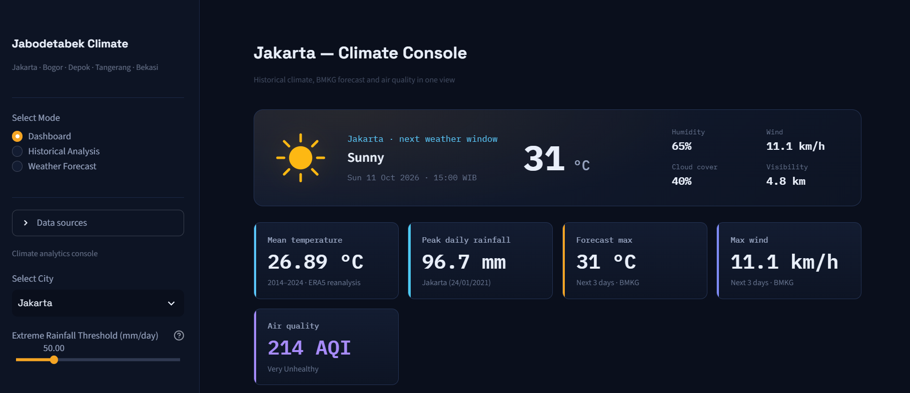
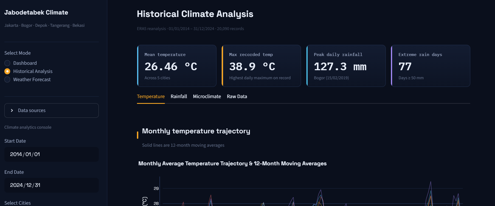
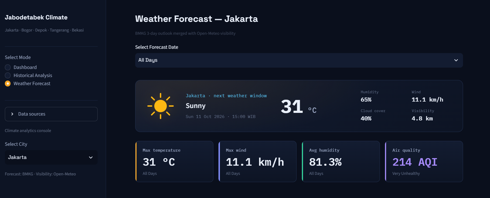

# Jabodetabek Climate Analytics

> A climate dashboard for the Greater Jakarta (Jabodetabek) region. Built with Streamlit, Plotly, and a custom design system — featuring historical decadal analysis, BMKG weather forecasts, and real-time air quality monitoring.

---

## Project Overview

This dashboard provides a unified interface for exploring **weather and climate data** across the five cities of Jabodetabek:

| City | Elevation | Key Climate Characteristic |
|------|-----------|---------------------------|
| **Jakarta** | 7 m | Urban Heat Island, flood-prone lowlands |
| **Bogor** | 290 m | "Rain City" — highest rainfall in region |
| **Depok** | 75 m | Transitional microclimate |
| **Tangerang** | 25 m | Coastal industrial zone |
| **Bekasi** | 30 m | Dense urban sprawl, elevated nighttime temps |

---

## Features

### Dashboard
- **Hero current conditions** — large-format temperature, weather icon, and key params (humidity, wind, cloud, visibility)
- **KPI instrument cards** — historical mean temp, peak rainfall, forecast max, max wind, AQI with colored gauge
- **Interactive 3-hour forecast carousel** — draggable, scroll-snap cards with smooth scrolling
- **Air quality gauge** — US AQI with threshold bands, pollutant breakdown, health recommendations

### Historical Analysis
- **Monthly temperature trends** — 12-month rolling averages reveal long-term warming signals
- **Extreme rainfall frequency** — annual counts of days ≥ configurable threshold (BMKG: 50 mm heavy, 100 mm very heavy)
- **Microclimate comparison** — box plots of monthly means highlighting Bogor's cooler/wetter profile vs. lowland metros
- **Raw data export** — download full ERA5 reanalysis dataset as CSV

### Weather Forecast
- **3-hour interval forecast cards** — condition, temp, humidity, wind, cloud, visibility
- **Temperature / Wind / Humidity-Cloud charts** — Plotly visualizations with dark theme
- **Merged visibility data** — Open-Meteo hourly visibility joined via nearest-timestamp merge
- **City selector** — instant switching between all 5 Jabodetabek cities

---

## Architecture

```
┌─────────────────────────────────────────────────────────────────┐
│                        Streamlit App (app.py)                   │
├─────────────────────────────────────────────────────────────────┤
│  ┌─────────────┐  ┌─────────────┐  ┌─────────────┐              │
│  │  Dashboard  │  │ Historical  │  │  Forecast   │  ← Pages     │
│  └──────┬──────┘  └──────┬──────┘  └──────┬──────┘              │
└─────────┼────────────────┼────────────────┼─────────────────────┘
          │                │                │
          ▼                ▼                ▼
┌─────────────────────────────────────────────────────────────────┐
│                        ui.py (Design System)                    │
│  ┌──────────┐ ┌────────┐ ┌──────────┐ ┌────────┐ ┌──────────┐  │
│  │  Hero    │ │  KPI   │ │Carousel  │ │ Gauge  │ │ Section  │  │
│  └──────────┘ └────────┘ └──────────┘ └────────┘ └──────────┘  │
└─────────────────────────────────────────────────────────────────┘
          │                │                │
          ▼                ▼                ▼
┌─────────────────────────────────────────────────────────────────┐
│                      charts.py (Plotly)                         │
│  ┌────────────┐ ┌────────────┐ ┌────────────┐ ┌────────────┐  │
│  │  Trends    │ │ Extremes   │ │  Micro-    │ │   AQI      │  │
│  │            │ │            │ │  climate   │ │ Pollutants │  │
│  └────────────┘ └────────────┘ └────────────┘ └────────────┘  │
└─────────────────────────────────────────────────────────────────┘
          │                │                │
          ▼                ▼                ▼
┌─────────────────────────────────────────────────────────────────┐
│                   weatherService.py (API Layer)                 │
│  ┌─────────────┐ ┌──────────┐ ┌─────────────┐ ┌────────────┐  │
│  │ ERA5 Archive│ │  BMKG    │ │Open-Meteo   │ │  CAMS AQ   │  │
│  │  (Historical)│ │ Forecast │ │ Visibility  │ │  (Air Qual)│  │
│  └─────────────┘ └──────────┘ └─────────────┘ └────────────┘  │
└─────────────────────────────────────────────────────────────────┘
```

---

## Quick Start

### Prerequisites
- Python 3.10+
- Internet connection (for API calls)

### Installation
```powershell
# Clone / navigate to project
cd Weather Analysis

# Create virtual environment (recommended)
python -m venv .venv
.\.venv\Scripts\Activate.ps1

# Install dependencies
pip install -r requirements.txt

# Run
streamlit run app.py
```

The app opens at `http://localhost:8501`.

---

## Dependencies

| Package | Version | Purpose |
|---------|---------|---------|
| `streamlit` | ≥1.32 | Web app framework |
| `pandas` | ≥2.2 | Data manipulation |
| `numpy` | ≥1.26 | Numerical ops |
| `plotly` | ≥5.20 | Interactive charts |
| `requests` | ≥2.31 | HTTP client |

All pinned in `requirements.txt`.

---

## Data Sources & Attribution

| Data | Source | License / Terms |
|------|--------|-----------------|
| **Historical Climate (ERA5)** | [Open-Meteo Archive API](https://open-meteo.com/en/docs/historical-weather-api) | Free for non-commercial |
| **Weather Forecast** | [BMKG API](https://api.bmkg.go.id/) | Indonesian Meteorological Agency |
| **Visibility Forecast** | [Open-Meteo Forecast API](https://open-meteo.com/en/docs) | Free for non-commercial |
| **Air Quality (CAMS)** | [Open-Meteo Air Quality API](https://open-meteo.com/en/docs/air-quality-api) | ECMWF CAMS model |
| **Weather Icons** | Custom inline SVG (in `weatherIcons.py`) | MIT |

> **Note**: Open-Meteo Archive API has a rate limit (~100 req/min). The app includes exponential backoff retry and 24-hour caching. If you hit a 429, wait 30–60s and retry.

---

## Project Structure

```
Weather Analysis/
├── app.py                      # Main entry point, page routing, rendering
├── charts.py                   # Plotly chart builders (dark theme applied)
├── ui.py                       # Reusable HTML/CSS components (hero, KPI, carousel, gauge)
├── dataProcessor.py            # Aggregation logic (monthly, annual, KPIs)
├── weatherService.py           # API clients with retry logic & caching
├── weatherIcons.py             # Inline SVG weather condition icons
├── assets/
│   └── style.css               # Complete design system (CSS custom properties)
├── .streamlit/
│   └── config.toml             # Streamlit theme configuration
├── requirements.txt            # Python dependencies
└── README.md                   # This file
```

---

## Screenshots

### Dashboard — Unified City View

*Hero current conditions, KPI cards, forecast carousel, AQI gauge*

### Historical Analysis — Decadal Trends

*Temperature trends, extreme rainfall, microclimate box plots*

### Weather Forecast — BMKG 3-Day

*3-hour interval cards, temperature/wind/humidity charts, pollutant small multiples*

---

## Configuration

### Environment Variables (optional)
```bash
# .env (create if needed)
OPEN_METEO_TIMEOUT=30          # Request timeout in seconds
BMKG_TIMEOUT=30                # BMKG API timeout
CACHE_TTL_HISTORICAL=86400     # Historical cache TTL (seconds)
CACHE_TTL_FORECAST=3600        # Forecast/AQI cache TTL
```

### Adjustable Parameters (in sidebar)
- **Date range** — Historical analysis window (default 2014–2024)
- **Cities** — Multi-select for comparative analysis
- **Extreme rainfall threshold** — Slider (20–150 mm/day, BMKG default 50)
- **Forecast city** — Single city for 3-day outlook

---

## Troubleshooting

| Issue | Cause | Fix |
|-------|-------|-----|
| `429 Too Many Requests` | Open-Meteo rate limit | Wait 30–60s; reduce cities; narrow date range |
| Blank charts / no data | API returned empty | Check internet; API may be temporarily down |
| Fonts not loading | Google Fonts blocked | App falls back to system fonts (Segoe UI / Consolas) |
| Carousel not draggable | JS blocked | Enable `unsafe_allow_javascript` (default on) |
| Theme looks wrong | Cached old CSS | Hard refresh (Ctrl+F5) or clear browser cache |

---

## License

MIT License — see [LICENSE](LICENSE) for details.

---

## Acknowledgments

- **BMKG** — for providing public weather forecast data
- **Open-Meteo / ECMWF** — for ERA5 reanalysis, forecast, and CAMS air quality APIs
- **Streamlit** — for the excellent rapid-prototyping framework
- **Plotly** — for interactive, publication-quality charts

---